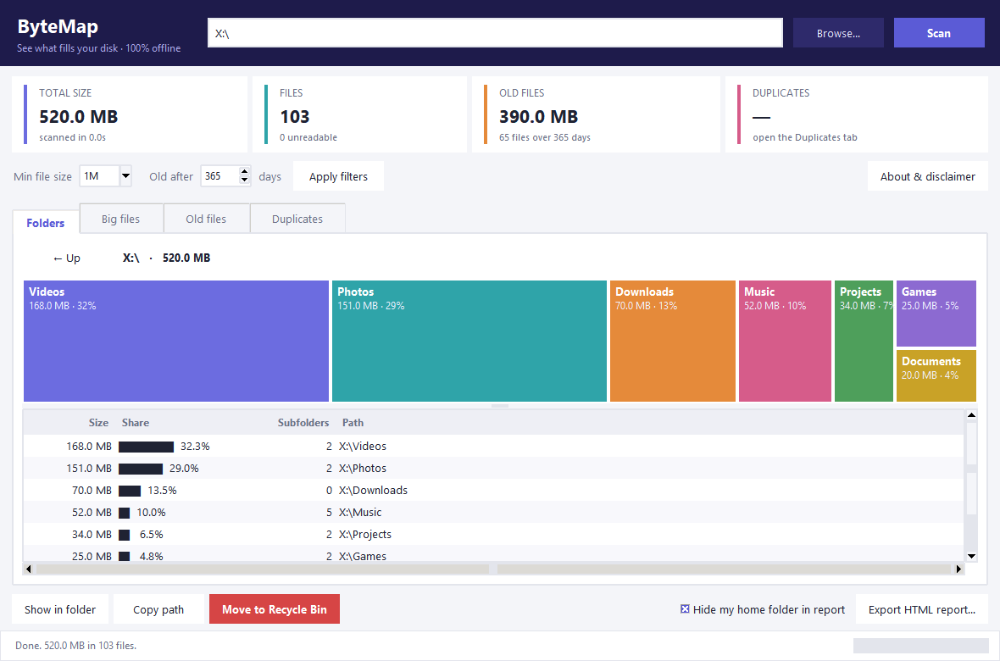

# ByteMap

Find out what fills your disk. ByteMap lists the biggest folders and files, old files you
forgot, and duplicate files. It writes an interactive HTML treemap report.

**Fully offline.** No telemetry, no network access, no data leaves your computer.
See [PRIVACY.md](PRIVACY.md).

**Manuale di istruzioni (italiano):** [docs/MANUALE.md](docs/MANUALE.md)



## Quick start (graphical interface)

Needs Python 3.10 or newer. Nothing else to install: the interface uses Tkinter, included with Python.

```sh
git clone https://github.com/makaDv/ByteMap.git
cd ByteMap
python -m bytemap
```

Or download the ZIP from GitHub, extract it and double-click `ByteMap.pyw`.

1. Pick a folder and press **Scan**.
2. Browse the tabs: **Folders** (double-click to drill down), **Big files**, **Old files**,
   **Duplicates** (press **Find duplicates**).
3. Select rows, then **Show in folder**, **Copy path** or **Move to Recycle Bin** (asks first).
4. **Export HTML report...** saves an interactive treemap.

On managed PCs where `pip` is blocked (for example by Device Guard), `python -m bytemap` from
the project folder still works. Do not try to bypass your organization's policies.

## Command line

Optional install, which adds the `bytemap` command (or run `python -m bytemap <command>`
from the project folder):

```sh
pip install .
```

```sh
bytemap scan D:\                       # biggest folders
bytemap big ~/Downloads --top 30       # biggest files
bytemap old . --days 730 --min-size 50M  # not modified for 2 years
bytemap dupes ~/Pictures               # duplicate files (default: 1 MB or larger)
bytemap report C:\Users --redact-home  # HTML report: bytemap-report.html
```

Common options: `--top N`, `--min-size 10M`, `--exclude DIR` (repeatable).

### Free up space

`bytemap trash` moves files to the Recycle Bin / Trash. It **never deletes permanently**.

```sh
bytemap trash old-video.mp4 setup.exe            # dry run: shows what would happen
bytemap trash old-video.mp4 setup.exe --apply    # asks you to type YES, then moves
bytemap trash --from-file list.txt --apply       # one path per line
```

ByteMap refuses filesystem roots, system folders (`C:\Windows`, `C:\Program Files`, `/usr`,
`/etc` and similar), symlinks and junctions.

## How it works

- Walks folders with `os.scandir`. It does not follow symlinks or junctions, so it never loops
  or counts a file twice.
- Duplicates: groups by size, then compares a SHA-256 of the first 64 KB, then a full SHA-256.
- The report is one HTML file with inline CSS/JS. It loads nothing from the internet.

## Privacy note about reports

A report contains file paths from your computer, which can include your name or document
titles. Keep it private, or create it with `--redact-home`. Report files are in `.gitignore`.

## Disclaimer

- ByteMap is free, non-commercial open source software, provided "as is", without warranty of
  any kind, to the maximum extent permitted by applicable law (see [LICENSE](LICENSE)).
- You use it at your own risk. Check what you move to the Recycle Bin and keep backups of
  important data.
- You are responsible for scanning only folders you are allowed to access, and for handling any
  personal data in them lawfully (for example under the GDPR).
- ByteMap is an independent project. It is not affiliated with or endorsed by Microsoft, Apple,
  the Python Software Foundation or any other company. Product names belong to their owners.

## Contributing

See [CONTRIBUTING.md](CONTRIBUTING.md). Please never post personal data (real paths,
screenshots of your files, reports) in issues.

## Third-party software

- [Send2Trash](https://github.com/arsenetar/send2trash), BSD-3-Clause license: moves files to
  the Recycle Bin / Trash.

## License

[MIT](LICENSE)
