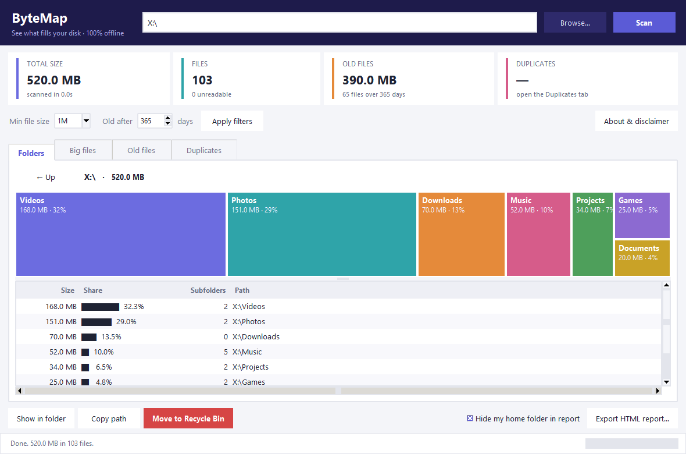
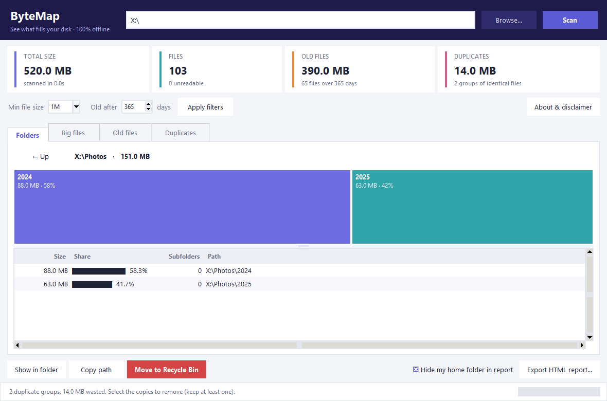
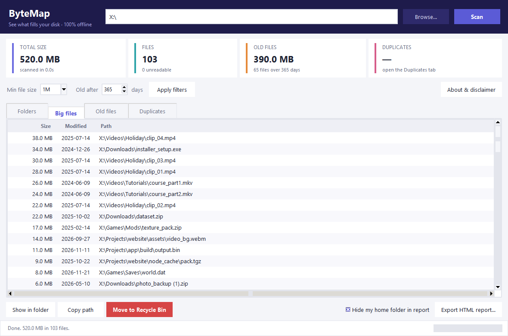
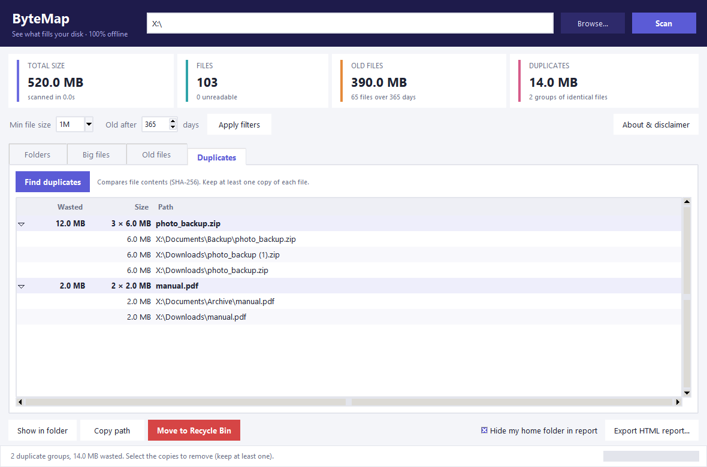

# Manuale di istruzioni di ByteMap

Versione 0.3 · Licenza MIT · Funziona completamente offline

ByteMap ti mostra cosa occupa spazio sul disco: cartelle e file più grandi, file vecchi e file
duplicati. Ti aiuta a liberare spazio spostando nel **Cestino** ciò che non ti serve più.

> Tutte le immagini di questo manuale usano una cartella dimostrativa con file finti (unità `X:`).

## Indice

1. [Requisiti](#1-requisiti)
2. [Scaricare ByteMap](#2-scaricare-bytemap)
3. [Avviare ByteMap](#3-avviare-bytemap)
4. [La finestra principale](#4-la-finestra-principale)
5. [Analizzare una cartella](#5-analizzare-una-cartella)
6. [Scheda Folders: dove finisce lo spazio](#6-scheda-folders-dove-finisce-lo-spazio)
7. [Schede Big files e Old files](#7-schede-big-files-e-old-files)
8. [Scheda Duplicates](#8-scheda-duplicates)
9. [Liberare spazio in sicurezza](#9-liberare-spazio-in-sicurezza)
10. [Esportare il report HTML](#10-esportare-il-report-html)
11. [Riga di comando](#11-riga-di-comando)
12. [Privacy e dati personali](#12-privacy-e-dati-personali)
13. [Problemi frequenti](#13-problemi-frequenti)
14. [Licenza e responsabilità](#14-licenza-e-responsabilità)

---

## 1. Requisiti

- Windows 10/11, macOS o Linux.
- Python 3.10 o più recente, da [python.org](https://www.python.org/downloads/).
  Su Windows, durante l'installazione spunta **Add python.exe to PATH**.
- Nient'altro per l'interfaccia grafica: usa Tkinter, già incluso in Python.
- Per spostare file nel Cestino serve il pacchetto `Send2Trash`
  (`python -m pip install Send2Trash`, se il tuo PC lo consente).

## 2. Scaricare ByteMap

**Con git:**

```bat
git clone https://github.com/makaDv/ByteMap.git
cd ByteMap
```

**Senza git:** sulla pagina GitHub del progetto premi **Code → Download ZIP**, estrai lo ZIP
e apri la cartella `ByteMap`.

## 3. Avviare ByteMap

Scegli uno dei modi:

| Modo | Come |
|---|---|
| Doppio clic | Apri `ByteMap.pyw` nella cartella del progetto. |
| Prompt dei comandi | Nella cartella del progetto: `python -m bytemap` |
| Con una cartella già scelta | `python -m bytemap gui D:\` |

> **PC aziendali (Device Guard, AppLocker o simili):** se `pip` o altri programmi sono bloccati,
> usa `python -m bytemap` dalla cartella del progetto. Non cercare di aggirare i criteri della
> tua organizzazione. In caso di dubbio chiedi al supporto IT.

## 4. La finestra principale



| Zona | A cosa serve |
|---|---|
| **Barra in alto** | Cartella da analizzare, **Browse…** per sceglierla, **Scan** per avviare. |
| **Schede riepilogo** | **Total size** (spazio totale), **Files** (numero di file e quanti non leggibili), **Old files** (spazio dei file vecchi), **Duplicates** (spazio sprecato dai doppioni). |
| **Filtri** | **Min file size**: ignora i file più piccoli. **Old after … days**: età minima dei file vecchi. Premi **Apply filters** dopo averli cambiati. |
| **Schede** | **Folders**, **Big files**, **Old files**, **Duplicates**. |
| **Pulsanti in basso** | **Show in folder**, **Copy path**, **Move to Recycle Bin**, **Export HTML report…** |
| **Barra di stato** | Messaggi e avanzamento. |

## 5. Analizzare una cartella

1. Scrivi il percorso nella barra in alto, oppure premi **Browse…**.
2. Premi **Scan** (o Invio).
3. Attendi la fine: la barra di stato mostra il risultato.

Puoi analizzare un intero disco (`C:\`, `D:\`), ma su dischi grandi serve qualche minuto.
Le cartelle senza permessi di lettura vengono saltate e contate come *unreadable*: è normale.

ByteMap non segue collegamenti simbolici né junction, quindi non conta due volte lo stesso file.

## 6. Scheda Folders: dove finisce lo spazio

- La **treemap** in alto mostra ogni sottocartella come un rettangolo: più è grande, più spazio
  occupa. Il riquadro grigio *(files here)* rappresenta i file nella cartella corrente.
- Passa sopra un riquadro per leggere percorso e dimensione nella barra di stato.
- **Clic su un riquadro** per entrarci. **← Up** per tornare alla cartella superiore.
- La **tabella** sotto elenca le stesse sottocartelle con dimensione, quota percentuale e numero
  di sottocartelle. Doppio clic su una riga per entrarci.
- Trascina il bordo tra treemap e tabella per cambiarne le proporzioni.



## 7. Schede Big files e Old files



- **Big files**: i 500 file più grandi sopra la dimensione minima.
- **Old files**: i file non modificati da almeno N giorni (impostazione **Old after**),
  dal più grande. Sono buoni candidati per l'archiviazione o la pulizia.
- Clic su un'intestazione di colonna per ordinare. Clic di nuovo per invertire.
- **Ctrl+clic** o **Maiusc+clic** per selezionare più righe.

## 8. Scheda Duplicates



1. Premi **Find duplicates**.
2. ByteMap confronta il **contenuto** dei file, non solo il nome: prima la dimensione, poi un
   hash SHA-256 parziale, poi quello completo. Due file nello stesso gruppo sono identici.
3. Ogni gruppo mostra in grassetto lo spazio sprecato e il numero di copie.
4. Seleziona le copie da eliminare e **lasciane sempre almeno una**. ByteMap blocca
   l'operazione se selezioni tutte le copie di un gruppo.

Su cartelle molto grandi il confronto può richiedere tempo: alza **Min file size** per velocizzarlo.

## 9. Liberare spazio in sicurezza

1. Seleziona una o più righe in qualsiasi scheda.
2. Premi **Move to Recycle Bin** (o il tasto **Canc**).
3. Controlla l'elenco nella finestra di conferma. La risposta predefinita è **No**.
4. Conferma con **Sì**. I file vanno nel **Cestino**: puoi ripristinarli da lì.
5. Svuota il Cestino di Windows solo quando sei sicuro: è da lì che lo spazio viene liberato
   davvero.

**Protezioni integrate:**

- ByteMap **non cancella mai in modo definitivo**.
- Rifiuta radici dei dischi e cartelle di sistema (`C:\Windows`, `C:\Program Files`,
  `C:\ProgramData`, `/usr`, `/etc` e simili), la tua cartella utente intera e `C:\Users`.
- Non sposta collegamenti simbolici o junction.
- Impedisce di eliminare tutte le copie di un duplicato.

**Consigli:**

- Non toccare cartelle di programmi installati, `AppData` o file che non riconosci.
- Fai un backup dei dati importanti prima di una pulizia estesa.
- Dopo aver spostato file, premi di nuovo **Scan** per aggiornare i totali.

## 10. Esportare il report HTML

1. Dopo una scansione premi **Export HTML report…** e scegli dove salvarlo.
2. Lascia spuntato **Hide my home folder in report** per sostituire `C:\Users\<nome>` con `~`.
3. Apri il file con il browser: contiene una treemap navigabile e le tabelle principali.

Il report è un unico file che **non carica nulla da internet** (niente font, CDN o tracker).
Contiene però percorsi del tuo computer: **non condividerlo** se sono privati.

## 11. Riga di comando

Tutti i comandi si lanciano dalla cartella del progetto:

| Comando | Cosa fa |
|---|---|
| `python -m bytemap scan D:\` | Cartelle più grandi |
| `python -m bytemap big C:\Users\nome\Downloads --top 30` | File più grandi |
| `python -m bytemap old . --days 730 --min-size 50M` | File non modificati da 2 anni |
| `python -m bytemap dupes C:\Users\nome\Pictures` | Duplicati (da 1 MB in su) |
| `python -m bytemap report C:\Users\nome --redact-home` | Report HTML |
| `python -m bytemap trash file.mp4` | Prova: mostra cosa farebbe, non sposta nulla |
| `python -m bytemap trash file.mp4 --apply` | Sposta nel Cestino dopo aver scritto `YES` |
| `python -m bytemap trash --from-file lista.txt --apply` | Un percorso per riga |

Opzioni comuni: `--top N`, `--min-size 10M`, `--exclude CARTELLA` (ripetibile).
Aiuto: `python -m bytemap --help` oppure `python -m bytemap <comando> --help`.

## 12. Privacy e dati personali

- ByteMap **non raccoglie, non invia e non salva** dati da nessuna parte. Non si connette a
  internet. Non ci sono statistiche d'uso, account o aggiornamenti automatici.
- Legge nomi, dimensioni e date dei file. Legge il contenuto solo per confrontare i possibili
  duplicati: gli hash restano in memoria e spariscono alla chiusura.
- Gli unici file che crea sono i report che esporti tu, dove scegli tu.
- Se analizzi cartelle con dati personali di altre persone (per esempio sul PC di lavoro),
  sei tu il responsabile di farlo nel rispetto delle norme applicabili, GDPR incluso,
  e delle regole della tua organizzazione.
- Quando segnali un problema su GitHub, **non pubblicare** percorsi reali, nomi, screenshot dei
  tuoi file o report. Sostituiscili con esempi come `C:\Users\UTENTE\...`.

Dettagli in [PRIVACY.md](../PRIVACY.md).

## 13. Problemi frequenti

| Problema | Soluzione |
|---|---|
| `"bytemap" non è riconosciuto` | Usa `python -m bytemap` dalla cartella del progetto. |
| `No module named bytemap` | Non sei nella cartella del progetto: `cd` nella cartella `ByteMap`. |
| `pip.exe bloccato da Device Guard` | La GUI non richiede pip: usa `python -m bytemap`. |
| `No module named send2trash` | Serve solo per il Cestino: `python -m pip install Send2Trash`, se consentito. |
| `python` non è riconosciuto | Reinstalla Python spuntando **Add python.exe to PATH**, oppure usa `py -m bytemap`. |
| Molte cartelle *unreadable* | Mancano i permessi: vengono saltate. Non avviare ByteMap come amministratore senza motivo. |
| La scansione è lenta | Analizza una cartella più piccola o alza **Min file size**. |
| Un file viene rifiutato | È in una cartella protetta, è un collegamento o non esiste più. |

## 14. Licenza e responsabilità

- ByteMap è software libero e gratuito, distribuito con licenza [MIT](../LICENSE).
- È fornito **"così com'è"**, senza garanzie di alcun tipo, nei limiti consentiti dalla legge.
- Lo usi a tuo rischio: controlla sempre cosa sposti nel Cestino e conserva backup dei dati
  importanti.
- ByteMap è un progetto indipendente, non affiliato né approvato da Microsoft, Apple, Python
  Software Foundation o altre aziende. I nomi dei prodotti appartengono ai rispettivi titolari.
- Componenti di terze parti: [Send2Trash](https://github.com/arsenetar/send2trash),
  licenza BSD-3-Clause.

Segnalazioni di sicurezza: [SECURITY.md](../SECURITY.md).
